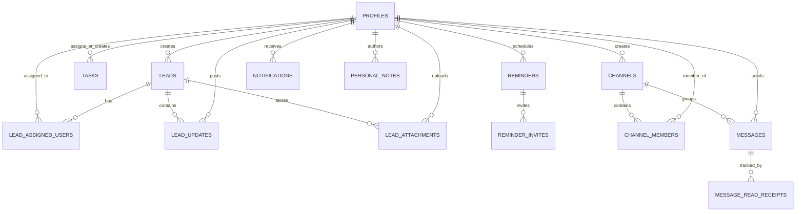

<div align="center">

# 🚀 RelayHQ
### *Enterprise Outbound Campaign Operations & Lead Execution Platform*

[](https://react.dev/)
[](https://www.typescriptlang.org/)
[](https://tailwindcss.com/)
[](https://supabase.com/)
[](https://vitejs.dev/)
[](LICENSE)

<p align="center">
  <b>RelayHQ</b> is a high-performance, real-time command center engineered for modern B2B outbound campaign management, sales pipeline execution, and team workflow orchestration. Built with an offline-resilient dual engine architecture, it bridges high-velocity lead tracking with Slack-style real-time collaboration, synthesizer-powered alarms, and Google Chat integration.
</p>

[Explore Features](#-core-features) • [Architecture](#-dual-engine-architecture) • [Role Matrix](#-role-based-access-control-rbac) • [Database Schema](#-database-schema--rls) • [Quickstart](#-quickstart-guide) • [Deployment](#-deployment)

---

</div>

## 📌 Executive Summary & Purpose

Outbound sales and campaign operations are traditionally fragmented across disconnected tools: static CRMs, disparate chat apps, siloed task managers, and third-party reminder tools. 

**RelayHQ** unifies this entire operational lifecycle into a single, cohesive workspace:
1. **Pipeline Execution**: Visual Kanban stage progression with demand source tagging and full audit trail histories.
2. **Team Coordination**: Internal real-time messaging with channels, direct messaging, and external Google Chat webhook mirroring.
3. **Accountability**: Multi-assignee task delegation with customizable recurrence engines, reminder offsets, and preview side-sheets.
4. **Time Sensitivity**: Built-in Web Audio synthesis alarms and background worker monitors to ensure deadlines and follow-ups are never missed.
5. **Universal Resilience**: Seamless operation out of the box with zero configuration via an in-memory PubSub simulator, paired with an instant switch to a live, secure Supabase PostgreSQL database.

---

## 🏗️ Dual-Engine Architecture

RelayHQ is designed with an **adaptive dual-engine database layer** abstracted behind a unified data access client (`dbClient`).

```
                              ┌───────────────────────────┐
                              │     RelayHQ Frontend      │
                              │  (React 19 + TypeScript)  │
                              └─────────────┬─────────────┘
                                            │
                                  Unified dbClient
                                            │
                   ┌────────────────────────┴────────────────────────┐
                   ▼                                                 ▼
     ┌───────────────────────────┐                     ┌───────────────────────────┐
     │   Mode A: Offline Sandbox │                     │   Mode B: Live Production │
     │      (Zero-Config)        │                     │         (Supabase)        │
     ├───────────────────────────┤                     ├───────────────────────────┤
     │ • In-memory mock store    │                     │ • PostgreSQL 15+          │
     │ • LocalStorage state sync │                     │ • Row-Level Security (RLS)│
     │ • PubSub event bus        │                     │ • Realtime WebSockets     │
     │ • Instant sandbox bypass  │                     │ • Google OAuth / Passwords│
     └───────────────────────────┘                     └───────────────────────────┘
```

### 1. Mode A: Zero-Config In-Memory Sandbox Simulator
- Ideal for zero-friction demonstrations, local development, staging tests, and offline execution.
- Emulates full CRUD, real-time reactive PubSub subscriptions, unread indicators, and persistence via `localStorage`.
- Includes automated mock seeding with realistic profiles (CEO, Department Heads, Specialists), pre-populated leads, task queues, and team message threads.

### 2. Mode B: Live Production Supabase Backend
- Enterprise-grade PostgreSQL database with strict **Row-Level Security (RLS)** policies.
- Real-time schema synchronization using Supabase WebSocket replication (`supabase_realtime`).
- Secure Google OAuth and Email/Password authentication.
- Fail-fast network guards: if live connections experience network latency or misconfiguration, the client safely falls back to sandbox mode within 4 seconds, guaranteeing 100% uptime with zero white-screen crashes.

---

## 👥 Role-Based Access Control (RBAC)

RelayHQ implements a four-tier hierarchical security and authorization model:

| Capability / Resource | 👑 CEO (`ashish.garg@...`) | 🎖️ Department Head | 🛠️ Developer (`rachit.malik@...`) | 💼 Growth Specialist |
| :--- | :---: | :---: | :---: | :---: |
| **System-Wide Dashboard Analytics** | Full Access | Full Access | Full Access | Assigned Scope |
| **Lead Portfolio Visibility** | All Leads | All Leads | All Leads | Created & Assigned Only |
| **Lead Creation & Editing** | ✅ | ✅ | ✅ | ✅ |
| **Delete Leads & Projects** | ✅ | ✅ | ✅ | Own Leads Only |
| **Task Delegation to Teammates** | ✅ | ✅ | ✅ | ✅ |
| **Edit Any Task** | ✅ | ✅ | ✅ | Creator Only |
| **Delete Any Task** | ✅ | ✅ | ✅ | Creator Only |
| **Access `#heads-only` Channel** | ✅ | ✅ | ✅ | ❌ |
| **Onboard New Employees** | ✅ | ✅ | ✅ | ❌ |
| **Permanent Teammate Deletion** | ✅ | ✅ | ✅ | ❌ |
| **Database & Webhook Config** | ✅ | ✅ | ✅ | ❌ |

---

## ✨ Core Features

### 1. 🎯 Dynamic Kanban Pipeline & Lead Relationship Management
- **Fluid HTML5 Drag-and-Drop**: Effortlessly advance prospects across sales lifecycle stages:
  $$\text{New} \longrightarrow \text{Contacted} \longrightarrow \text{Qualified} \longrightarrow \text{Proposal} \longrightarrow \text{Negotiation} \longrightarrow \text{Closed Won / Closed Lost}$$
- **Outbound Demand Typologies**: Segment leads by acquisition channels: *Cold Outreach, Warm Outbound, Referral, Inbound Request, MQL*.
- **Comprehensive Lead Dossier**: Store target company details, contact phone/email, LinkedIn profiles, deal value, tags, notes, and asset attachments.
- **Audit Trail & Activity Log**: Timestamped record of every stage progression, note entry, and file upload with teammate mention notifications (`@Teammate`).

### 2. 💬 Slack-Inspired Collaboration & Google Chat Mirroring
- **Channel Partitioning**:
  - `#everyone`: Company-wide announcements, milestones, and updates.
  - `#specialists-only`: Outreach strategy discussions and playbooks.
  - `#heads-only`: Restricted, confidential channel for CEO and Department Heads.
- **Direct Messaging (DMs)**: Private 1-on-1 conversations with realtime read receipts and active presence counters.
- **Rich Format Preservation**: Formatted code snippets, bullet points, bold/italic text, and file attachments.
- **Google Chat Webhook Forwarding**: Every message sent within RelayHQ channels or direct messages is mirrored to your external Google Chat Space via webhook integration, keeping teams aligned on mobile and desktop.

### 3. ⚡ Task Operations Center with Slide-Over Previews
- **Multi-Assignee Support**: Assign single specialists or assemble cross-functional task forces across action items.
- **Side-Sheet Details Drawer**: Clicking any task card opens a responsive 500px slide-over sheet (collapsing into a clean full-screen drawer on mobile) displaying complete parameters, recurrence intervals, deadline countdowns, and attachments.
- **Creator & Head Inline Editing**: Tasks can be edited directly inside the side-sheet by their original creator or Department Heads.
- **Recurrence Automation Engine**: Configure tasks to repeat on *Daily, Weekly, or Monthly* cadences with configurable interval multipliers and optional sunset dates. Completing a recurring task automatically calculates the next deadline and spawns the next occurrence.
- **Attachment Management**: Upload, preview, and delete file assets with instant reactive badge updates.

### 4. ⏰ Synthesized Reminders & Continuous Alarm Subsystem
- **Zero-Asset Web Audio Synthesizer**: Audio alerts generated mathematically via the browser's `AudioContext` API:
  - *Chime Sounds*: Classic Dual-Sine, Sonar Sweep, Digital Square Beep, Zen Harmonic chord.
  - *Continuous Alarms*: Sawtooth Triple-Stab, Dynamic Triangle Siren, Bell Ring, Digital Pulse.
- **Unthrottled Background Web Worker**: Utilizes dedicated browser Web Workers to prevent timer throttling in background tabs, ensuring mission-critical alarms fire on the exact second even when minimized.
- **Native Desktop Push Notifications**: Integrates with the HTML5 Notifications API to alert users on desktop systems.

### 5. 📊 Executive & Operational Dashboards
- **Pipeline Funnel Visualization**: Real-time conversion tracking across each pipeline milestone.
- **Specialist Workload & Performance Matrix**: High-level inspection of lead quotas, pending tasks, won conversion ratios, and productivity metrics.
- **Live Teammate Presence Room**: ClickUp-inspired presence indicators (*Online, Idle, Busy, Offline*). Automatically detects inactivity after 5 minutes and returns to online upon mouse movement or keypress.

### 6. 📝 Playbooks & Personal Scratchpad
- **Rich-Text Notes Engine**: Pre-draft cold outreach email copy, qualification call scripts, and meeting agendas.
- **Automatic Auto-Saving**: Persists edits on blur and dropdown adjustments with zero manual save friction.
- **Direct Lead Association**: Bind scratchpad notes directly to prospect cards for quick access during discovery calls.

### 7. 🧭 Hash-Based History & Browser Navigation
- Fully synchronized with `window.location.hash` (`/#dashboard`, `/#leads`, `/#tasks`, `/#reminders`, `/#notes`, `/#messaging`, `/#settings`).
- Complete browser **Back** and **Forward** button support without losing application state or triggering page refreshes.

### 8. 🎨 Customization & Multi-Theme Engine
- Pre-built presets: *Default Modern, Dark Minimalist, Midnight Blue, Warm Sepia*.
- Custom primary color picker, card contrast options, font family switcher, and audio tone selectors.

---

## 🗄️ Database Schema & RLS

RelayHQ's production schema is defined in [`schema.sql`](schema.sql) with strict PostgreSQL foreign key constraints and Row-Level Security (RLS) policies.



### Key Security & Integrity Features:
- **Cascading Deletions**: Deleting a profile automatically cascades deletions to their tasks, reminders, private notes, notifications, and updates, preventing foreign key constraint violations (`ERROR 23503`).
- **Head Privilege Overrides**: The SQL helper function `public.is_head()` securely verifies whether `auth.uid()` has the `'head'` role or matches recognized administrative and CEO email domains.
- **Co-Assignee RLS Access**: Tasks and leads support multi-assignee read/write policies using `auth.uid() = ANY(assignee_ids)` and `is_assigned_to_lead()`.

---

## ⌨️ Keyboard Command System

Boost operational speed with global keyboard navigation:

| Key Binding | Action |
| :--- | :--- |
| <kbd>Ctrl</kbd> + <kbd>K</kbd> or <kbd>⌘</kbd> + <kbd>K</kbd> | Open Global Command Palette |
| <kbd>?</kbd> | Open Keyboard Shortcuts Guide |
| <kbd>1</kbd> - <kbd>7</kbd> | Quick-jump to Views (1: Dashboard, 2: Leads, 3: Tasks, 4: Reminders, etc.) |
| <kbd>N</kbd> | Quick-create New Lead |
| <kbd>T</kbd> | Quick-create New Task |
| <kbd>R</kbd> | Quick-create New Reminder |
| <kbd>J</kbd> / <kbd>K</kbd> | Navigate up/down through task and list cards |
| <kbd>Enter</kbd> / <kbd>Space</kbd> | Toggle status of highlighted item |
| <kbd>Delete</kbd> | Delete highlighted item |

---

## 🚀 Quickstart Guide

### 1. Prerequisites
- **Node.js**: v18.0.0 or higher
- **npm** or **pnpm** / **yarn**

### 2. Installation
Clone the repository and install project dependencies:
```bash
git clone https://github.com/rachitmalik-byte/workflow-conversation.git
cd workflow-conversation
npm install
```

### 3. Launch Development Server
```bash
npm run dev
```
Navigate to `http://localhost:5173`. The application will start in **Zero-Config Sandbox Mode** with complete mock datasets.

### 4. Build for Production
To generate a production-ready optimized build:
```bash
npm run build
```
Verify the output assets in the `dist/` directory.

---

## 🔗 Connecting to Live Supabase Backend

1. Navigate to [Supabase](https://supabase.com) and create a new project.
2. Open the **SQL Editor** in your Supabase dashboard.
3. Paste the contents of [`schema.sql`](schema.sql) and execute the query to build all tables, constraints, functions, and RLS policies.
4. In RelayHQ, log in with an administrative email or click the **Settings** icon.
5. In the **Database Connection** tab, paste:
   - **Supabase Project URL**: `https://<your-project-id>.supabase.co`
   - **Supabase Anon Public Key**: `eyJhbGciOi...`
6. Click **Save Configuration**. The app will immediately authenticate with your live cloud database.

---

## 💬 Setting Up Google Chat Webhook Forwarding

1. Open your team's **Google Chat** workspace.
2. Navigate to your target Space or create a new one (e.g., `#outbound-sync`).
3. Click the Space name at the top ➔ **Apps & integrations** ➔ **Webhooks**.
4. Click **Add Webhook**, name it `RelayHQ Bot`, and click **Save**.
5. Copy the generated webhook URL.
6. In RelayHQ, navigate to **Settings ➔ Notifications**, paste the Webhook URL, and save.
7. Messages sent in RelayHQ will now automatically mirror directly into Google Chat!

---

## 📦 Deployment

### Deploying to Vercel
This repository includes a [`vercel.json`](vercel.json) file configured to handle client-side routing and rewrite rules.

1. Push your code to your GitHub repository.
2. Go to [Vercel](https://vercel.com) and click **Add New Project**.
3. Import the `workflow-conversation` repository.
4. Under **Environment Variables**, add:
   - `VITE_SUPABASE_URL` = `<Your Supabase Project URL>`
   - `VITE_SUPABASE_ANON_KEY` = `<Your Supabase Anon Key>`
5. Click **Deploy**. Vercel will build and deploy the app with automatic CI/CD on every push to `main`.

---

## 🛡️ License

This project is licensed under the **MIT License** — see the [LICENSE](LICENSE) file for details.

---

<div align="center">
  <sub>Engineered with precision for high-velocity outbound teams. Built by the RelayHQ Engineering Team.</sub>
</div>
